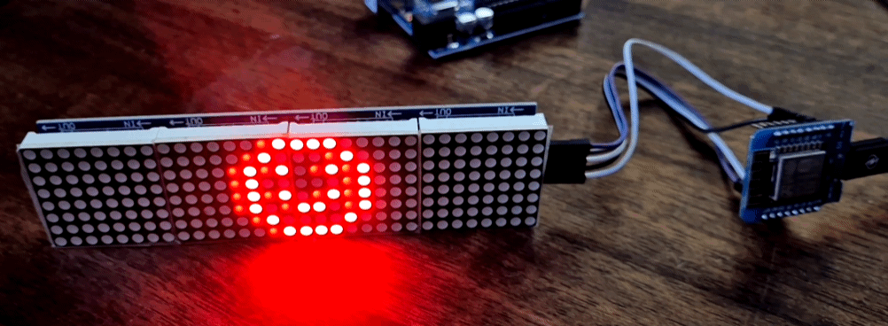
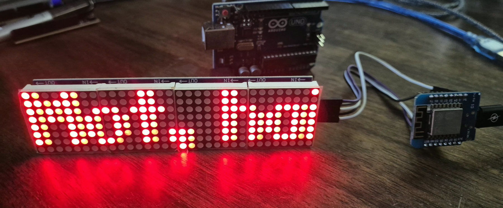

# ESP8266 32x8 LED Matrix: Vietnamese Scroller & Animations

A small Arduino sketch for the **Wemos/LOLIN D1 mini (ESP8266)** and a **4-in-1 MAX7219 8x8 LED matrix** (FC-16 style, 32x8 pixels). It scrolls Vietnamese text and plays a set of small pixel animations in a loop.

## Features

- Scrolling Vietnamese phrases (without diacritics, see [Limitations](#limitations))
- 7 built-in animations: beating hearts, winking smiley, Pac-Man chase, bouncing ball, sine wave, matrix rain, equalizer
- Adjustable scroll speed and brightness
- Uses hardware SPI for fast updates

## Hardware

- Wemos/LOLIN D1 mini (ESP8266)
- 4-in-1 8x8 LED matrix module with MAX7219 drivers (the matrices are marked `1088AS`)
- 5 jumper wires

### Wiring

| Display | D1 mini        |
|---------|----------------|
| VCC     | **5V**         |
| GND     | **G**          |
| DIN     | **D7** (MOSI)  |
| CLK     | **D5** (SCK)   |
| CS      | **D8**         |

Connect to the **input** side of the module chain (the side labelled `DIN`, not `DOUT`).

### Power: use 5 V

The MAX7219 is specified for 4.0 to 5.5 V. The module may work from the 3V3 pin, but that pin is fed by the D1 mini's small onboard regulator (about 500 mA), which also powers the ESP8266. Four modules can draw close to 1 A with all LEDs lit at full brightness, so powering the display from the **5V pin** (straight from USB) is safer.

The 3.3 V logic signals from the D1 mini are normally enough for the MAX7219, so no level shifter is needed.

Tips:

- Keep `BRIGHTNESS` moderate (0 to 7 is plenty indoors); brightness is the main driver of current.
- Use a USB supply that can deliver at least 1 A and a decent cable.
- If you see random resets, add a 100 to 470 µF capacitor across VCC and GND at the display.

## Software setup

1. Install the [Arduino IDE](https://www.arduino.cc/en/software) and add ESP8266 board support (`http://arduino.esp8266.com/stable/package_esp8266com_index.json` under *Preferences → Additional Boards Manager URLs*).
2. Install these libraries via the Library Manager:
   - **MD_Parola**
   - **MD_MAX72XX**
3. Select the board **LOLIN(WEMOS) D1 R2 & mini**.
4. Open `vietnam_display.ino`, then compile and upload.

## Configuration

Settings at the top of `vietnam_display.ino`:

| Setting        | Default | Meaning                                              |
|----------------|---------|------------------------------------------------------|
| `SCROLL_SPEED` | `30`    | Delay per scroll step in ms. Lower is faster.        |
| `BRIGHTNESS`   | `3`     | LED brightness, 0 to 15.                             |
| `MIRROR_X`     | `false` | Mirror the animations horizontally.                  |
| `FLIP_Y`       | `false` | Flip the animations vertically.                      |
| `phrases[]`    |         | The scrolling texts. Edit or add your own.           |

To add an animation, write a function that draws frames with `beginFrame()`, `px(x, y)` and `endFrame()`, then add it to the `animations[]` array.

## Troubleshooting

- **Text is mirrored, flipped or garbled:** change `FC16_HW` to `GENERIC_HW`, `PAROLA_HW` or `ICSTATION_HW`.
- **Animations are mirrored but the text is fine:** toggle `MIRROR_X` / `FLIP_Y`.
- **Nothing lights up:** check that you are on the `DIN` side of the module and that DIN, CLK and CS are not swapped.
- **Dim or flickering display:** check the power supply and cable, and see the power notes above.
- **Board won't boot:** on the ESP8266, D8 (GPIO15) must be low at boot. If that causes trouble, move CS to D6 and update `CS_PIN`.

## Limitations

The built-in font has no Vietnamese diacritics, and an 8-pixel-high display leaves very little room for accents. The text is therefore written without them (for example "Xin chao" instead of "Xin chào"). A custom font could add accented letters.
